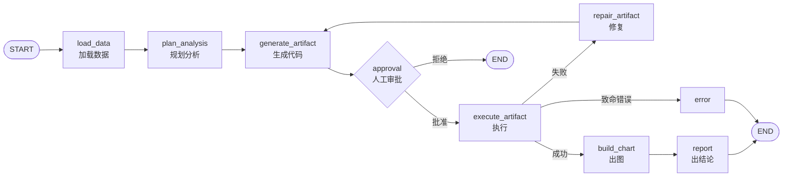

<div align="center">

# DataPilot 

**用自然语言分析数据的 Agent 系统**

上传 CSV / Excel / SQLite，用中文提问，自动完成 **加载 → 规划 → 生成 SQL/Python → 人工审批 → 执行 → 出图 → 出结论**，并支持多轮追问。

</div>

---

<p align="center">
  <a href="#"></a>
  <a href="#"></a>
  <a href="#"></a>
  <a href="#"></a>
  <a href="#"></a>
  <a href="#"></a>
</p>

---

##  目录

- [  特性](#-特性)
- [ 系统架构](#️-系统架构)
- [ 快速开始](#-快速开始)
  - [本地运行](#本地运行)
  - [Docker](#docker)
- [ 配置](#️-配置)
- [ 项目结构](#-项目结构)
- [ API 接口](#-api-接口)
- [ 开发 & 测试](#-开发--测试)
- [ 路线图](#️-路线图)
- [ 贡献](#-贡献)
- [ 许可证](#-许可证)

---

## ✨ 特性

-  **自然语言分析** — 用中文直接提问，无需手写 SQL 或 Python。
-  **多数据源** — 支持 `CSV` / `Excel` / `SQLite`，自动推断 Schema。
-  **智能规划** — 基于 LangGraph 编排，先规划后执行，过程可追溯。
-  **自适应执行引擎** — 按数据源与规模在 `pandas` / `SQL` / `dask` / `DuckDB` 间自动选择。
-  **人工审批** — 代码/SQL 执行前可人工审阅（`CODE_APPROVAL_ENABLED`）。
-  **自动修复** — 执行失败时自动 `repair_artifact` 重试，直到成功或达到上限。
-  **自动出图** — 基于结果生成 ECharts 图表规格（折线 / 柱状 / 饼图等）。
-  **自动结论** — 输出数据洞察与可读分析报告。
-  **多轮追问** — 基于对话记忆，支持在同一数据集上连续追问。
-  **完整前后端** — Vue 3 前端 + FastAPI 后端，开箱即用。

---

##  系统架构

Agent 流程由 LangGraph 编排，节点如下：



**技术栈**

| 层 | 选型 |
|---|---|
| 前端 | Vue 3 + TypeScript + Vite + Element Plus + ECharts（`web/`） |
| 后端 | FastAPI + LangGraph（`server/` + `agent/`） |
| 执行引擎 | pandas / SQL / dask / DuckDB（`executors/`） |
| LLM | Moonshot Kimi（`llm/`，可配置） |
| 检查点 | Redis（`langgraph-checkpoint-redis`） |

---

##  快速开始

### 本地运行

> 需要 Python 3.11+ 与 Node.js 18+。

```bash
# 1. 安装 Python 依赖
pip install -r requirements.txt

# 2. 配置环境变量
cp .env.example .env          # 编辑 .env，填入 KIMI_API_KEY

# 3. 启动后端（终端 1）
uvicorn server.main:app --reload --port 8000

# 4. 启动前端（终端 2）
cd web && npm install && npm run dev   # http://localhost:5173
```

不启前端也可访问 `http://localhost:8000/docs` 调试接口。

### Docker

```bash
cp .env.example .env
docker compose up -d --build   # http://localhost:8000
docker compose down            # 停止
```

---

##  配置

复制 `.env.example` 为 `.env`，关键变量：

| 变量 | 说明 | 默认值 |
|---|---|---|
| `KIMI_API_KEY` | **必需**，模型服务密钥 | — |
| `KIMI_MODEL` | 模型名（平台会上下架，务必显式配置） | `kimi-k2-0905-preview` |
| `KIMI_BASE_URL` | 模型服务地址 | `https://api.moonshot.cn/v1` |
| `CODE_APPROVAL_ENABLED` | 代码/SQL 执行前是否需人工审批 | `true` |
| `DASK_ROW_THRESHOLD` | 超过此行数优先选 dask | `50000` |

其余可选项见 `.env.example`。

---

##  项目结构

```
server/    FastAPI 接口层（任务 / 文件 / SSE）
web/       Vue 3 前端（上传、提问、审批、出图）
agent/     LangGraph 流程编排
executors/ 执行引擎（pandas / sql / dask / duckdb）
loaders/   数据加载（csv / excel / sqlite）
analysis/  report / memory / summarize
viz/       chart_spec 生成
safety/    代码沙箱 / SQL 校验
llm/       LLM 客户端
core/      配置与通用工具
tests/     后端 pytest
```

---

##  API 接口

后端基于 FastAPI，提供以下 REST / SSE 接口：

| 方法 | 路径 | 说明 |
|---|---|---|
| `GET` | `/health` | 健康检查 |
| `POST` | `/files` | 上传数据文件 |
| `POST` | `/tasks` | 创建分析任务 |
| `GET` | `/tasks/{task_id}` | 查询任务状态与结果 |
| `POST` | `/tasks/{task_id}/resume` | 审批通过后继续执行（或拒绝） |
| `DELETE` | `/tasks/{task_id}` | 取消 / 删除任务 |
| `GET` | `/tasks/{task_id}/events` | SSE 实时事件流（进度上报） |

完整交互式文档见 `http://localhost:8000/docs`。

**典型流程**

1. `POST /files` 上传 CSV/Excel/SQLite；
2. `POST /tasks` 提交问题，触发 Agent 流程；
3. 若需审批，前端通过 `/tasks/{task_id}/events` 收到待审批事件；
4. `POST /tasks/{task_id}/resume` 携带 `approved=true/false` 继续或终止；
5. 最终结果（表格、图表规格、洞察、报告）通过接口或 SSE 返回。

---

##  开发 & 测试

```bash
python -m pytest tests -q     # 后端测试（不联网）
cd web && npm run test         # 前端测试
cd web && npm run build        # 构建
```

代码规范使用 `ruff`（配置见 `ruff.toml`），开发依赖见 `requirements-dev.txt`。

---

##  路线图

- [ ] 更多数据源（Parquet、MySQL、PostgreSQL）
- [ ] 图表交互式下钻
- [ ] 分析报告导出（PDF / Markdown）
- [ ] 多文件联合分析
- [ ] 用户鉴权与任务历史持久化

---

##  贡献

欢迎 Issue 与 PR！

1. Fork 本仓库并创建特性分支（`git checkout -b feature/xxx`）；
2. 提交改动（`git commit -m 'feat: ...'`）；
3. 推送分支（`git push origin feature/xxx`）；
4. 提交 Pull Request。

提交前请确保通过 `ruff` 检查与 `pytest`。

---

##  许可证

本项目尚未声明开源许可证，仅供学习与研究使用。如需商用或二次分发，请先联系作者。

---

> 详细设计文档见 [`docs/`](./docs/)。
